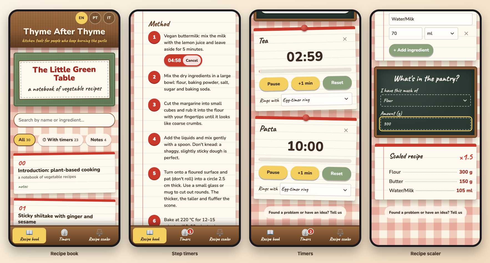
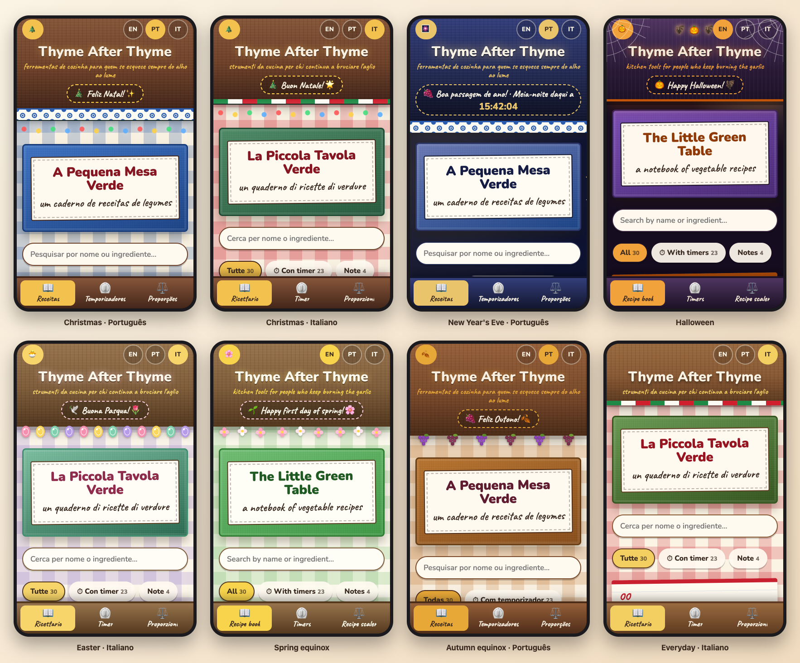

<div align="center">


# *Thyme After Thyme*

**Kitchen tools for people who keep burning the garlic.**

A recipe book with a timer on every step, proper kitchen clock sounds, a recipe scaler that works on your chosen recipes, and a wardrobe of festive themes. Classic, quiet and elegant.
In English, Português and Italiano. Built phone-first for people with flour on their hands.

[](https://github.com/alex-quiterio/thyme-after-thyme/actions/workflows/pages.yml)


### 👉 [**Open the app**](https://alex-quiterio.github.io/thyme-after-thyme/)



</div>

---

## ✨ What's inside

### 📖 A recipe book that cooks with you
- **30 vegetable recipes in three languages**, from *A Pequena Mesa Verde* / *The Little Green Table* / *La Piccola Tavola Verde*.
- **Every time written in a step becomes a button.** "Cook 5–7 minutes" turns into a ⏱ **5–7 min** chip that starts a real timer, right where you're reading. It keeps running on the Timers tab, and rings even if you wander off to another page.
- **Tick off ingredients and steps** as you go. Your place is remembered, so a sleeping phone or a reload doesn't lose it.
- **Search by name or ingredient** (accent-insensitive), filter to recipes with timers, jump straight to *Ingredients* or *Method*.
- **Bring your own recipes**: import JSON or Markdown, remove what you don't want, restore the defaults any time.

### 👩‍🍳 Built for real kitchens
| | |
|---|---|
| ☀️ **Screen stays on** | while a recipe is open, so it doesn't go dark mid-sauce (you can switch it off) |
| 🔠 **Text size A / A+ / A++** | readable from across the counter; remembered |
| 👍 **Thumb-reach tab bar** | bottom navigation on phones, tablets and phones on their side; steps out of the way while you type |
| 👆 **Big tap targets** | everything is at least 44 px; tap a whole step to tick it |
| 🔔 **Timers you can't miss** | sound, system notification, vibration, flashing tab title and an app-icon badge, plus a badge on the Timers tab while any timer runs |
| ➕ **+1 min** | "needs one more minute" without starting over |
| 📴 **Works offline** | install it to your home screen; timers survive reloads and updates |

### 🎨 A classic look, and a wardrobe of themes
The everyday page is deliberately quiet: ivory paper, deep teal and a touch of red, serif type (Cormorant Garamond, Lora, Jost), hairline rules and a faint botanical drawing of thyme behind it. The look then follows the calendar, and the **language you're reading in**: Portuguese gets an azulejo tile border, Italian the tricolore ribbon, and the festive themes add their own colours.

<div align="center">

</div>

| Theme | When | Local touches |
|---|---|---|
| 🎄 **Christmas** | 24–26 Dec | *Boa Consoada* · *Buona Vigilia*, string lights, golden sparks (PT) or snow |
| 🥂 **New Year's Eve** | 31 Dec – 1 Jan | countdown to midnight, 12 grapes 🍇 (PT), red for luck at *Capodanno* (IT) |
| 🎃 **Halloween** | 30 Oct – 1 Nov | cobwebs, bats and a glowing title; *Pão-por-Deus* · *Ognissanti* on the 1st |
| 🐣 **Easter** | Good Friday – Easter Monday (moves every year) | painted eggs, sugared almonds; *Pasquetta* |
| 🌸 **Spring equinox** | the astronomical day (about 20 Mar) | blossoms and petals |
| 🍇 **Autumn equinox** | the astronomical day (about 22–23 Sep) | grape clusters for *vindima* / *vendemmia*, falling leaves |

They switch on by themselves and off again afterwards. A small button in the header turns the festive look off for good (remembered). To preview any of them today, add `?theme=` to the address:

[`?theme=xmas`](https://alex-quiterio.github.io/thyme-after-thyme/?theme=xmas) ·
[`?theme=nye`](https://alex-quiterio.github.io/thyme-after-thyme/?theme=nye) ·
[`?theme=halloween`](https://alex-quiterio.github.io/thyme-after-thyme/?theme=halloween) ·
[`?theme=easter`](https://alex-quiterio.github.io/thyme-after-thyme/?theme=easter) ·
[`?theme=spring`](https://alex-quiterio.github.io/thyme-after-thyme/?theme=spring) ·
[`?theme=autumn`](https://alex-quiterio.github.io/thyme-after-thyme/?theme=autumn) ·
`?theme=none` for the everyday look.

### ⏲️ Timers, with proper kitchen sounds
Several timers at once, each with its own name and sound: egg-timer ring, oven beeps, service bell, dinner chime. The sounds are synthesized in the browser (Web Audio), so there are no audio files to ship. They live in their own package, [`@kitchen/sounds`](packages/sounds), if you want them elsewhere.

### ⚖️ A recipe scaler that works on your recipes
Pick the recipes you're cooking (or press **Scale this recipe** on any recipe page) and the scaler reads their ingredient lists in all three languages ("300 g de arroz", "2 c. de sopa", "1 ½ cups", "3–4 tbsp"…).

- **Make ×½ · 1 · 2 · 3 · 4**, a custom number, or **"I have 150 g of rice"** and everything else follows.
- Ingredients without a quantity ("salt", "to taste") stay as they are, under *as needed*.
- Pick several recipes and an **All together** list adds up the same ingredient in the same unit.
- Not every recipe can be scaled, only those with real quantities (26 of the 29 recipes with an ingredient list can). Picks and multipliers are remembered.
- You can still scale your own typed list; it understands `1/2`, `1 1/2` and `1,5`.

---

## 🚀 Quick start

```bash
bun install
bun run web:dev       # bundle the recipes, then start the dev server
```

| Command | What it does |
|---|---|
| `bun run web:dev` | dev server |
| `bun run web:build` | production build (+ PWA files) into `apps/web/dist` |
| `bun run check` | recipes bundle and translation check, lint, typecheck, all tests |
| `bun run recipes:export out.json` | export every recipe, in every language, to one JSON file |

Pushing to `main` runs `check` and deploys to GitHub Pages.

---

## 🧱 How it's built

One web app, many tools. A small shell (header, tabs, language, themes, updates) hosts the tools, and each tool is its own slice with the same four layers:

```
apps/web/src/
├─ shell/             header, tab bar, language switcher, update prompt
├─ shared/            locales, seasons and themes, small hooks
├─ integrations/      the only glue between tools (recipe step → timer, tab badge)
└─ tools/<tool>/
   ├─ domain/          pure rules, no libraries
   ├─ application/     use cases + ports (clock, alarm, storage…)
   ├─ infrastructure/  adapters (Web Audio, localStorage, notifications…)
   └─ ui/              React components + messages in en / pt / it
```

ESLint enforces the dependency direction (`ui → application → domain`, `infrastructure → application → domain`), forbids tools importing each other, and bans `../` imports across folders. Only `main.tsx` wires adapters in.

**Stack:** Bun · TypeScript 7 · React 19 · no UI framework · Web Audio · service worker. **Quality:** 80+ unit tests, translation-consistency check, and every UI behaviour checked in a real browser at phone, tablet and landscape sizes.

<details>
<summary><b>🌍 Languages</b></summary>

English, Portuguese and Italian, switchable in the header (saved on the device, defaulting to the browser language). To share a link in a given language, add `?lang=pt` (or `en`, `it`): `https://alex-quiterio.github.io/thyme-after-thyme/?lang=it`. Interface text lives in `ui/messages.ts` next to each tool, typed `Localized<…>`, so a missing translation fails the build. Recipes are translated by hand; the Portuguese set is the original.

To add a language: add it to `shared/locales.ts`, fill in each `messages.ts` (TypeScript lists what's missing), and add a `content/recipes/<lang>/` folder.
</details>

<details>
<summary><b>📝 Adding and editing recipes</b></summary>

Recipes live in `content/recipes/{pt,en,it}/`, one file per recipe per language, named `NN — Title.md` with the **same number in every language**. The number is the recipe's id, so the same recipe stays open when you switch language.

```markdown
# Tomato toast

## Ingredients
  - 2 slices sourdough
  - 2 ripe tomatoes

## Method
Toast the bread for 3 minutes.
Crush the tomato on top.
```

Each line under *Method* is a step, and "3 minutes" becomes a timer button.

A recipe can also be a `.json` file (sections of `ingredients`, `steps` and `text`, in the order you write them, with optional explicit `timers` on a step). See [`content/recipe.example.json`](content/recipe.example.json) and [`content/recipe.schema.json`](content/recipe.schema.json); add `"$schema": "./recipe.schema.json"` for editor validation. Markdown and JSON can be mixed.

- Files are validated at build time, with the exact place of any mistake.
- `bun run recipes:check` fails if the languages differ in structure (sections, bullets, steps, timers), because step timers are matched by position.
- Times are recognised in Portuguese, English and Italian ("5–7 minutos", "2–3 hours", "30 secondi").
- Set `RECIPES_DIR=/path/to/folder` (containing `pt/`, `en/`, `it/`) to read recipes from anywhere.
</details>

<details>
<summary><b>📥 Your own recipes (import and remove)</b></summary>

The recipes above ship as the default book. At the bottom of the recipe list, **Manage my recipes** has an **Import** button that accepts a single recipe JSON, a list, a full export (from `bun run recipes:export`), or Markdown. Files are validated first, valid recipes are kept even if others in the file fail, and the problems are listed. Imports are saved on the device and tagged "yours".

- A recipe whose number matches a default replaces it (your version wins, only in the language you're reading in).
- A file that doesn't name a language shows in every language, without overwriting an existing translation.
- **Remove from my book** (on each recipe) hides it in every language; **Restore default recipes** brings the defaults back. Importing an unchanged default does nothing.
</details>

<details>
<summary><b>🔔 How timer alerts work (and their limits)</b></summary>

Timers are saved on the device (a running timer keeps its absolute end time), so reloading, closing the app or accepting an update doesn't lose them. A timer that ran out while the app was closed shows as finished and rings as soon as the app is opened.

A finished timer alerts in layers: a looping sound, a system notification (only when the app isn't in front; permission is asked when you start your first timer, and tapping it brings the app forward), vibration, a flashing tab title and an app-icon badge. While a timer runs the screen is kept awake, and the clock runs in a worker so background tabs aren't throttled.

*Limits:* a web app can't wake itself once the phone freezes it (battery saver, app killed). Then the alarm sounds the moment you open the app, not at the exact second. Notifications, vibration and the badge depend on the browser (on iPhone, notifications need the app added to the Home Screen; vibration isn't supported). Autoplay rules can keep the sound muted until the first tap after a reload.
</details>

<details>
<summary><b>📲 Install it, and how updates arrive</b></summary>

Open the site in Chrome and use **Install app** in the header (or the install icon in the address bar); on Android and iOS use "Add to Home screen". It runs in its own window, works offline, and has shortcuts for each tool.

A new version installs in the background and waits. The app shows "A fresher batch is ready" (checked every 30 minutes and whenever you return); **Update now** reloads into it (your running timers are kept), **Later** dismisses it until the next load.

How it's built: `public/manifest.webmanifest` and icons, plus `public/sw.js` as a service-worker template. `scripts/postbuild.ts` copies the icons and generates `dist/sw.js` with the list of built files to precache.
</details>

<details>
<summary><b>🧩 Adding a tool</b></summary>

Create `tools/<name>/{domain,application,infrastructure,ui}`, add an alias in `tsconfig.json`, add the name to `TOOLS` in `eslint.config.js`, and register it in `main.tsx`. A tool can show a tab badge by providing `useBadge`. Tools talk to each other only through ports wired up in `integrations/`.
</details>

---

## 🗺️ What's next

The roadmap lives in [**GitHub Issues**](https://github.com/alex-quiterio/thyme-after-thyme/issues): cook mode, shopping lists, categories and favourites, a recipe editor, unit conversion, a meal planner, and more. Timers that survive reloads and reliable background alerts are already done.

## 🙋 Feedback

Cooking with it and something's off, or you have an idea? [**Tell us**](https://github.com/alex-quiterio/thyme-after-thyme/issues/new). Every screen also has a feedback link at the bottom.

<div align="center">

*Made in the kitchen, between batches.* 🍳

</div>
